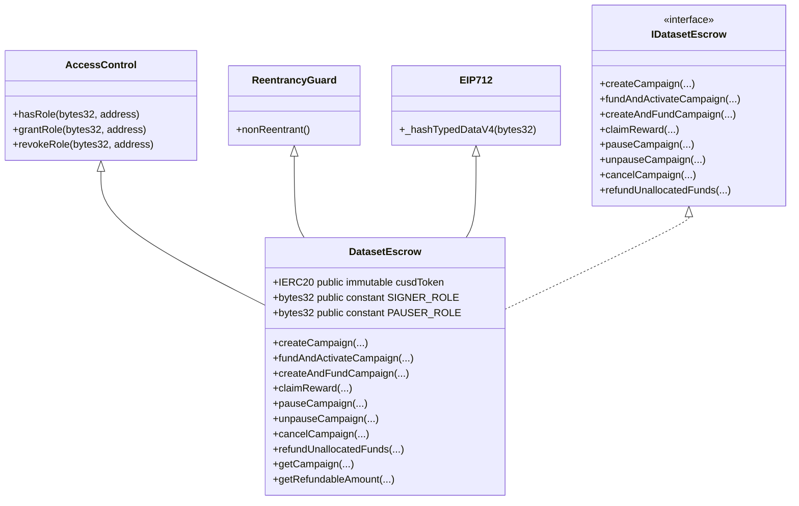
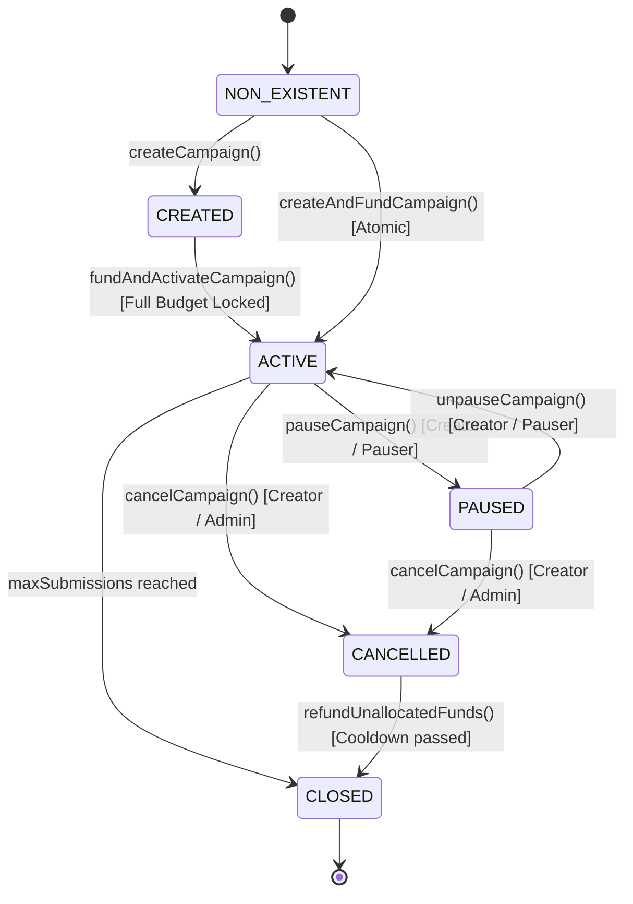
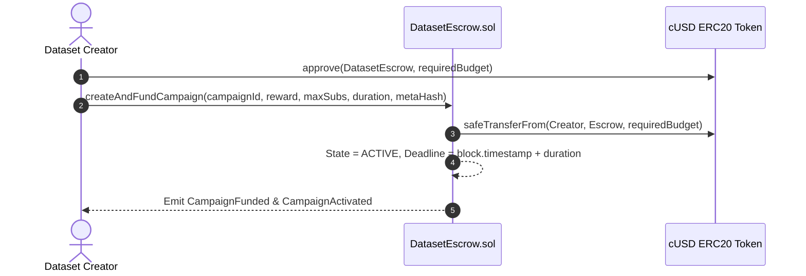
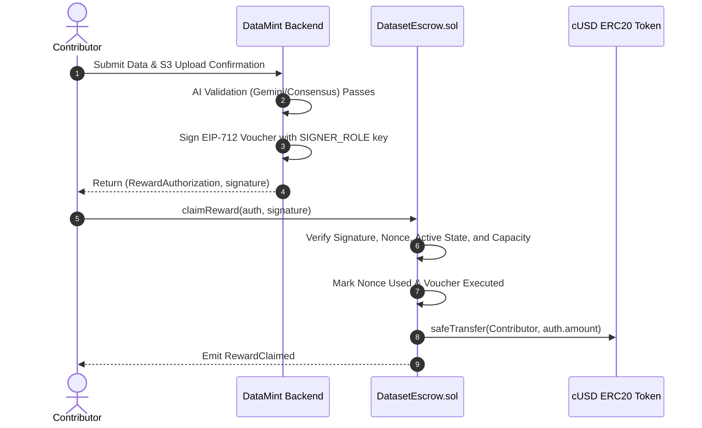
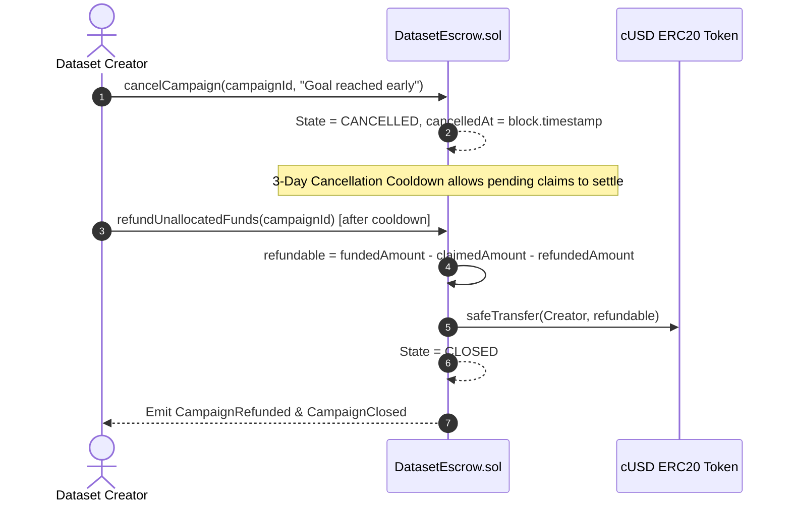

# DataMint Smart Contract Architecture & Specification

## 1. Executive Summary

`DatasetEscrow.sol` is the core on-chain financial settlement contract for DataMint. It implements upfront cUSD escrow funding for AI dataset collection campaigns, cryptographically verifiable EIP-712 reward claims for contributors, and deterministic refund settlements on Celo.

The contract enforces the fundamental economic invariant:
$$\text{Total Funded} = \text{Total Claimed} + \text{Total Reserved} + \text{Total Available} + \text{Total Refunded}$$

---

## 2. Contract Architecture & Inheritance



### 2.1 Dependencies
- **Solidity Version:** `0.8.24` (Cancun EVM, optimized with 200 runs).
- **OpenZeppelin Contracts v5.6.1:**
  - `SafeERC20`: Prevents non-standard ERC20 transfer failures from desynchronizing contract accounting.
  - `AccessControl`: Role-based governance (`DEFAULT_ADMIN_ROLE`, `SIGNER_ROLE`, `PAUSER_ROLE`).
  - `ReentrancyGuard`: Non-reentrancy on all state-changing fund transfers.
  - `EIP712` & `ECDSA`: Standardized cryptographic message digest and signer recovery.

---

## 3. Campaign Lifecycle State Machine



---

## 4. EIP-712 Reward Authorization Specification

DataMint decouples compute-heavy off-chain AI validation from on-chain fund distribution. An authorized platform signer produces an EIP-712 signature over a structured authorization.

### 4.1 Domain Separator
```solidity
EIP712Domain {
    string name: "DataMint DatasetEscrow"
    string version: "1"
    uint256 chainId: block.chainid // 42220 for Celo Mainnet
    address verifyingContract: <DatasetEscrow address>
}
```

### 4.2 TypeHash and Struct
```solidity
bytes32 public constant REWARD_AUTHORIZATION_TYPEHASH = keccak256(
    "RewardAuthorization(bytes32 campaignId,address contributor,uint256 amount,bytes32 nonce,uint256 deadline)"
);

struct RewardAuthorization {
    bytes32 campaignId;
    address contributor;
    uint256 amount;
    bytes32 nonce;
    uint256 deadline;
}
```

---

## 5. Sequence Diagrams

### 5.1 Creator Campaign Creation & Full Upfront Funding


### 5.2 Contributor Reward Claim (Pull Payment)


### 5.3 Campaign Cancellation & Safe Refund

