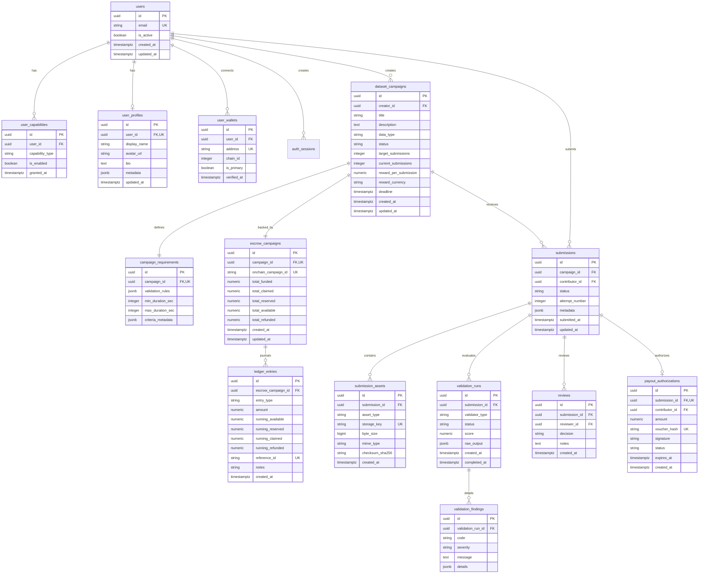

# DataMint Database Design & ERD

## 1. Overview and Relational Principles

The DataMint database is hosted on PostgreSQL 16. It is designed to replace legacy ad-hoc schemas with an ACID-compliant, strictly normalized schema with explicit foreign keys, check constraints, composite uniqueness rules, and audit trails.

### Design Principles:
1. **UUIDv7 / UUID Primary Keys:** All primary keys use UUID to enable distributed generation and prevent enumeration attacks.
2. **Explicit Foreign Keys with Deletion Protection:** Sensitive records (`users`, `campaigns`, `ledger_entries`, `submissions`) enforce `ON DELETE RESTRICT` to prevent accidental orphaned financial or audit records.
3. **Immutable Ledgers:** The `ledger_entries` table is insert-only. Balances are derived or verified against running totals.
4. **Strict Check Constraints:** Non-negative balances, allowed enum strings, and timestamp sequences (`completed_at >= created_at`) are guaranteed at the database engine level.

---

## 2. Entity Relationship Diagram (ERD)

---

## 3. Database Indexes and Constraints

### 3.1 Primary Constraints
- `user_wallets.address`: Lowercased unique index to prevent duplicate case-variant registrations.
- `escrow_campaigns.campaign_id`: 1:1 foreign key with `dataset_campaigns`.
- `payout_authorizations.submission_id`: Unique constraint enforcing at most one payout voucher per approved submission.
- `ledger_entries.reference_id`: Unique constraint to prevent duplicate processing of on-chain tx hashes or internal payout UUIDs.

### 3.2 Performance Indexes
- `dataset_campaigns(status, created_at DESC)`: For marketplace querying and filtering.
- `submissions(campaign_id, status)`: For campaign submission counts and progress tracking.
- `submissions(contributor_id, created_at DESC)`: For contributor dashboard history.
- `ledger_entries(escrow_campaign_id, created_at ASC)`: For reconstructing audit trails.
