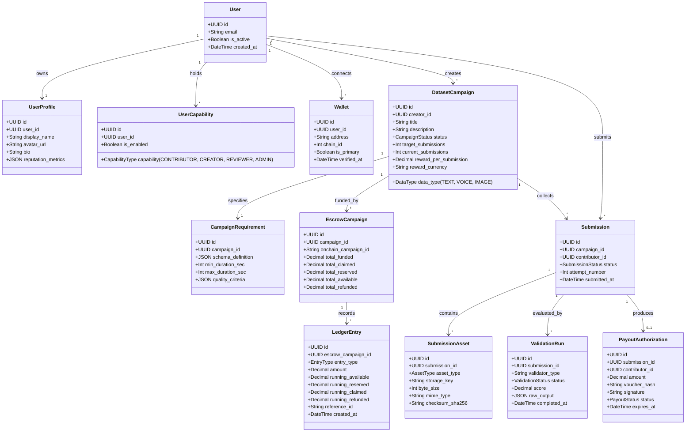

# DataMint Domain Model

## 1. Domain Entities and Aggregates

The DataMint domain model establishes explicit boundaries between identity, marketplace campaigns, submission workflows, validation pipelines, and financial ledger settlements.

---

## 2. Entity Lifecycle & Invariants

### 2.1 Identity & Capabilities
- **Capability Independence:** `UserCapability` records whether a user is authorized for `CONTRIBUTOR`, `CREATOR`, `REVIEWER`, or `ADMIN` roles. An individual account holds multiple capabilities concurrently.
- **Wallet Ownership:** A user must authenticate ownership of each wallet via EIP-4361 signature verification before the wallet is activated for payouts or campaign funding.

### 2.2 Campaigns & Escrow Alignment
- A `DatasetCampaign` starts in `DRAFT`.
- A campaign CANNOT transition to `ACTIVE` until `EscrowCampaign` records an on-chain deposit event confirmed by the ledger.
- While `ACTIVE`, the reward per submission is frozen. Modifying the reward requires creating a new campaign version to protect contributor trust.

### 2.3 Submissions & Validation Pipeline
- Submissions are created in `PENDING_UPLOAD`. Once client uploads the media asset directly to S3 and signals completion, status transitions to `QUEUED_FOR_VALIDATION`.
- An asynchronous worker dispatches the submission to an AI validator (or automated rule engine).
- If validation passes (`score >= threshold`), submission transitions to `APPROVED`, automatically allocating a payout reservation in the financial ledger.
- If validation is borderline or flagged, status transitions to `NEEDS_REVIEW`.
- If rejected, contributor may view specific findings and optionally appeal.

### 2.4 Payout Authorizations & Claims
- Upon `APPROVED` state, a `PayoutAuthorization` (cryptographic EIP-712 voucher) is generated and signed by the platform operator key.
- The contributor executes a pull-payment transaction on Celo by submitting the voucher to `DataMintEscrow.sol`.
- Upon on-chain confirmation, the submission transitions to `SETTLED`, and the ledger marks the reserved amount as `CLAIMED`.
