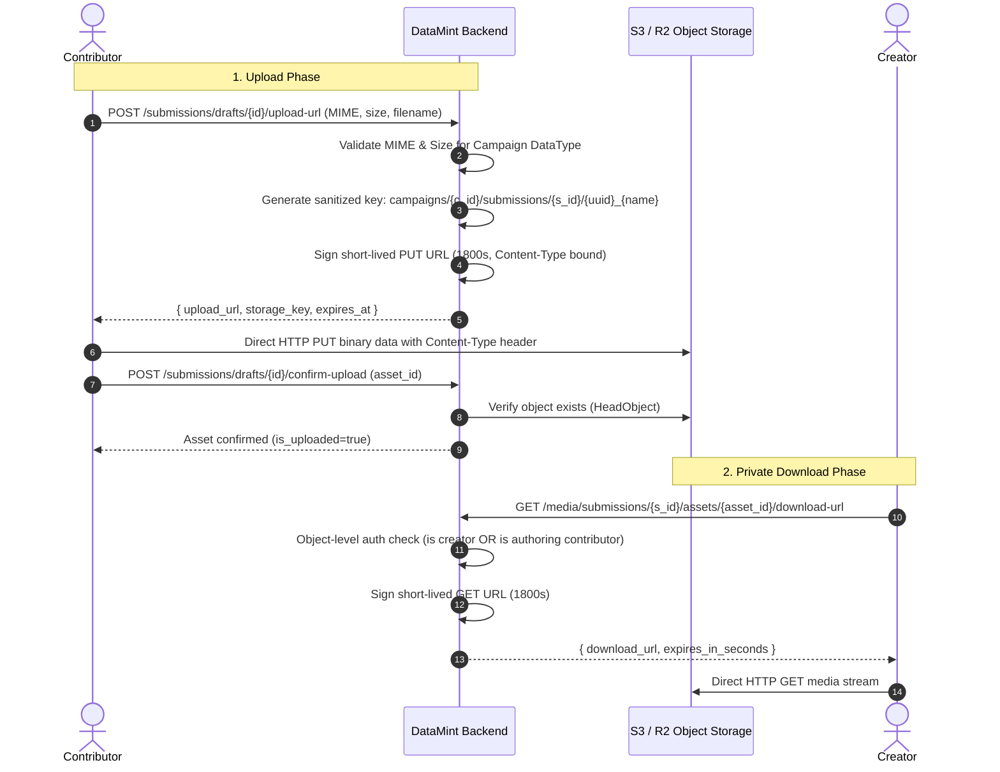

# Secure Media Storage Architecture

## 1. Overview & Security Model

In DataMint, human-contributed dataset assets—specifically voice recordings, camera captures, and unstructured documents—constitute private intellectual property funded by creators. Submissions must **never** be exposed via public object storage buckets or unauthenticated endpoints.

To enforce confidentiality, high throughput, and minimal server bandwidth overhead, DataMint employs an **S3-compatible Direct Presigned Upload & Download** architecture.



---

## 2. Storage Provider Abstraction

The storage system is abstracted via a Python `Protocol` (`StorageProvider`), allowing production environments to target AWS S3, Cloudflare R2, MinIO, or Google Cloud Storage without modifying application domain logic.

```python
class StorageProvider(Protocol):
    def generate_presigned_upload_url(
        self, object_key: str, mime_type: str, max_size_bytes: int, expires_in_seconds: int = 1800
    ) -> str: ...

    def generate_presigned_download_url(
        self, object_key: str, expires_in_seconds: int = 1800
    ) -> str: ...

    def verify_object_exists(self, object_key: str) -> bool: ...

    def delete_object(self, object_key: str) -> bool: ...
```

---

## 3. MIME Type & Size Constraints

Before any presigned upload URL is generated, the backend strictly validates file specifications against the campaign's target `DataType`:

| Data Type | Allowed MIME Types | Maximum Byte Size |
|:---|:---|:---|
| **VOICE** | `audio/wav`, `audio/x-wav`, `audio/mpeg`, `audio/mp3`, `audio/ogg`, `audio/webm`, `audio/m4a` | 50 MB (`52,428,800` bytes) |
| **IMAGE** | `image/jpeg`, `image/png`, `image/webp` | 20 MB (`20,971,520` bytes) |
| **TEXT** | `text/plain`, `application/json`, `text/csv` | 5 MB (`5,242,880` bytes) |

Any request with unpermitted MIME types (e.g. `application/x-executable`, `application/zip`) or sizes exceeding the thresholds is rejected immediately with `400 Bad Request`.

---

## 4. Key Naming and Path Traversal Defense

To prevent path traversal (`../../`), filename collisions, and namespace sniffing:
1. Contributor-provided filenames are sanitized:
   - Strips directory components (`os.path.basename`).
   - Normalizes whitespace to underscores.
   - Replaces any non-alphanumeric, non-hyphen, non-period character with an underscore: `re.sub(r"[^\w\.-]", "_", name)`.
2. Storage keys are namespaced hierarchically with UUID prefixes:
   `campaigns/{campaign_id}/submissions/{submission_id}/{asset_uuid}_{sanitized_filename}`

---

## 5. Object-Level Access Control

Asset download URLs are never public. Access to `GET /api/v1/media/submissions/{submission_id}/assets/{asset_id}/download-url` enforces strict authorization:
- **Submitting Contributor:** Permitted to download and inspect their own submitted media.
- **Campaign Creator:** Permitted to download and inspect media submitted to campaigns they own.
- **Third Parties / Other Users:** Rejected with `400 Bad Request` (`FORBIDDEN_MEDIA_ACCESS`).
