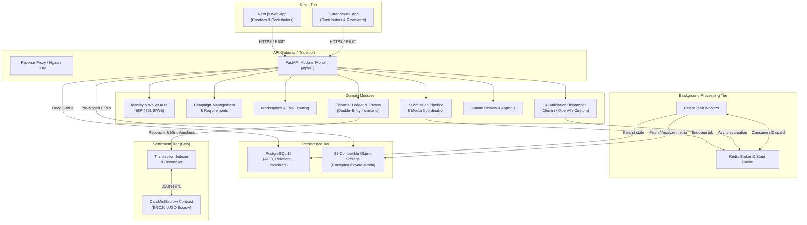

# DataMint Architecture Overview

## 1. Executive Summary

DataMint is a decentralized, human-powered AI dataset marketplace built on Celo. It connects dataset creators—who require high-quality, verified human data for training and evaluating machine learning models—with global contributors who earn micropayments (cUSD) for their submissions.

The platform is designed around the core operational principle:
> **DataMint must remain operationally useful even when the blockchain or an AI provider is temporarily unavailable.**

Contributors can browse tasks, creators can manage campaign parameters, submissions can be queued and evaluated, and settlement vouchers can be issued and reconciled deterministically without duplicating transactions or exposing escrow funds to race conditions.

---

## 2. High-Level System Architecture

DataMint is built as a **modular monolith** with a shared backend serving multiple clients and integrating external decentralized protocols and AI evaluation pipelines.



---

## 3. Core Architectural Principles

### 3.1 Unified Identity with Dual Capabilities
A single human user account (`users`) has access to both `contributor` and `creator` capabilities. Rather than partitioning the system into separate accounts or backends, capabilities are flags and profiles linked to one authenticated identity. Users can create a voice dataset campaign today and submit image labels tomorrow without switching credentials.

### 3.2 Non-Custodial User-Owned Wallets
DataMint never creates, stores, or manages private keys or seed phrases. Users authenticate by signing cryptographic challenges using standard EIP-4361 (Sign-In with Ethereum / Celo). Wallets are mapped to users in `user_wallets` and verified by signature.

### 3.3 Strict Financial Invariant Enforcement
All escrow and payout accounting follows double-entry principles. The campaign balance invariant:
$$\text{Funded} = \text{Claimed} + \text{Reserved} + \text{Available} + \text{Refunded}$$
is maintained immutably in the PostgreSQL ledger (`ledger_entries`) and reconciled with on-chain smart contract events. No balance is stored merely as an arbitrary mutable counter without a corresponding ledger journal.

### 3.4 Resilient Asynchronous Processing
External services (AI validation providers like Gemini/OpenAI, and Celo RPC nodes) are wrapped in idempotent, queued background workers. When an AI provider rate limits or experiences downtime, submissions remain safely in `QUEUED_FOR_VALIDATION` state with exponential backoff. When blockchain gas spikes or an RPC fails, settlement vouchers remain valid and pull-payment claims can be retried at any time.

### 3.5 Media Privacy via Ephemeral Pre-Signed URLs
Raw contributor recordings, images, and documents are stored in private S3 buckets. Neither public URLs nor permanent direct access are exposed. Clients upload directly to S3 via short-lived pre-signed PUT URLs, and creators access approved datasets via short-lived pre-signed GET URLs generated upon authenticated request.

---

## 4. Repository Structure

The DataMint repository adheres to a clean separation of concerns:

```
datamint/
├── backend/                   # Python FastAPI Modular Monolith
│   ├── alembic/               # Database migrations
│   ├── app/
│   │   ├── api/v1/            # API endpoints grouped by domain router
│   │   ├── core/              # Config, database session, logging, security
│   │   ├── models/            # SQLAlchemy 2.0 ORM models
│   │   ├── schemas/           # Pydantic v2 validation contracts
│   │   ├── services/          # Pure business logic and domain orchestrators
│   │   └── workers/           # Celery tasks and event handlers
│   ├── tests/                 # Unit and integration tests (Pytest)
│   ├── Dockerfile
│   └── pyproject.toml
├── contracts/                 # Foundry / Solidity smart contracts
│   ├── src/                   # DataMintEscrow.sol and interfaces
│   ├── test/                  # Contract unit and fuzz tests
│   └── foundry.toml
├── docs/                      # Architectural specifications & ADRs
│   ├── architecture/
│   ├── api/
│   └── decisions/
├── src/                       # Existing Next.js frontend (preserved)
└── .github/workflows/         # CI/CD automation
```
