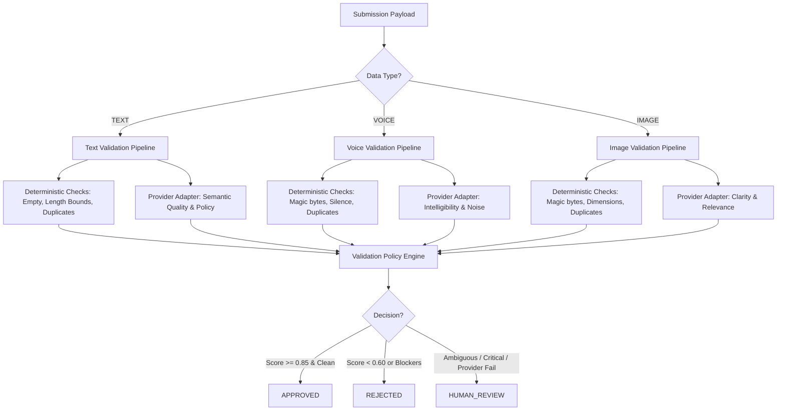
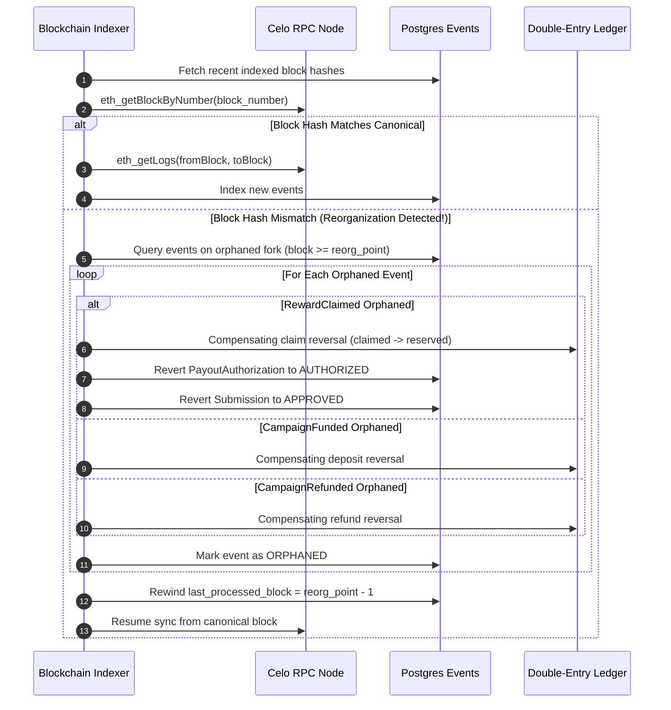

# Phase 4: AI Validation, Review Pipelines & Financial Orchestration

## 1. System Overview

Phase 4 completes DataMint's mission-critical processing pipeline:
$$\text{Submission} \longrightarrow \text{AI Validation} \longrightarrow \text{Human Review (if ambiguous)} \longrightarrow \text{Approval} \longrightarrow \text{EIP-712 Reward Authorization} \longrightarrow \text{On-Chain Claim} \longrightarrow \text{Financial Reconciliation}$$

The architecture enforces the strict financial invariant:
$$\text{Funded} = \text{Available} + \text{Reserved} + \text{Claimed} + \text{Refunded}$$

Under no circumstances does AI or human review directly touch cryptographic private keys or transfer on-chain funds. Approved submissions create reward eligibility, allowing the backend to issue cryptographically signed EIP-712 vouchers for contributor-initiated pull payments on Celo.

---

## 2. Multi-Modal AI Validation Architecture

DataMint decouples AI validation into provider-independent pipelines across three modalities, standardizing all outputs to reproducible `ValidationRun` and `ValidationFinding` records:



### 2.1 Modality Checks

1. **Text Validation:**
   - Empty/whitespace detection (`EMPTY_TEXT_SUBMISSION`, `BLOCKER`).
   - Character/word count bounds (`TEXT_LENGTH_UNDERFLOW`, `TEXT_LENGTH_OVERFLOW`).
   - Deterministic SHA-256 duplicate detection across campaign submissions.
   - Provider semantic checks: instruction compliance, spam detection, language requirements.

2. **Voice Validation:**
   - Binary header signature decodability (WAV, MP3, OGG, WebM, M4A).
   - Low-energy silence detection (`AUDIO_SILENCE_DETECTED`).
   - Cryptographic SHA-256 duplicate audio detection.
   - Provider acoustic checks: intelligibility, signal-to-noise ratio, transcription alignment.

3. **Image Validation:**
   - Binary magic number verification (JPEG, PNG, WebP).
   - Zero-payload and corrupted file detection.
   - Cryptographic image duplicate detection.
   - Provider visual evaluation: clarity, resolution, subject matter relevance.

### 2.2 Provider Independence
The system interfaces through the `AIValidationProvider` protocol, enabling hot-swapping between frontier providers (Gemini, OpenAI, Anthropic, Databricks via Neon AI Gateway) or local offline mock providers without touching business logic.

---

## 3. Validation Policy & Decision Engine

The `ValidationPolicyEngine` transforms findings into deterministic outcomes:
- **`APPROVED`**: Confidence score $\ge 0.85$ with zero blocker/critical findings.
- **`REJECTED`**: Hard deterministic blockers present, or confidence $< 0.60$.
- **`HUMAN_REVIEW`**: Moderate confidence ($0.60 \le s < 0.85$), critical findings with ambiguity, campaign-mandated manual inspection (`force_human_review`), or provider failure.

> [!IMPORTANT]
> **Safety Rule:** AI provider timeouts or network exceptions never result in automatic approval; they automatically route to `HUMAN_REVIEW`.

---

## 4. Human Review & Contributor Appeals

Submissions requiring manual resolution enter reviewer queues (`/api/v1/reviews/queue`):
1. **Conflict of Interest Protection:** Reviewers are strictly forbidden from evaluating their own contributions (`ConflictOfInterestException`).
2. **Review Decisions:** Reviewers submit `APPROVED` or `REJECTED` with mandatory rejection reasons.
3. **Appeals Workflow:**
   - Contributors can appeal rejected submissions within campaign-configured appeal windows (e.g. 7 days or campaign deadline).
   - Appeals are tracked under `UNDER_APPEAL` and reviewed by independent reviewers.
   - Reviewers can uphold (`UPHELD`) or overturn (`OVERTURNED`) the rejection.
   - Overturned appeals transition submission to `APPROVED`, making it eligible for reward authorization.

---

## 5. EIP-712 Reward Authorization & Signing Infrastructure

DataMint implements pull-payment authorizations conforming strictly to `DatasetEscrow.sol`:

### 5.1 EIP-712 Domain and Struct
```solidity
EIP712Domain {
    name: "DataMint DatasetEscrow"
    version: "1"
    chainId: 42220 // Celo
    verifyingContract: <DatasetEscrow address>
}

RewardAuthorization {
    bytes32 campaignId;
    address contributor;
    uint256 amount;
    bytes32 nonce;
    uint256 deadline;
}
```

### 5.2 Authorization Flow
1. Verify submission is in `APPROVED` state.
2. Verify campaign is `ACTIVE` and escrow has sufficient `total_available` balance.
3. Resolve contributor's primary verified wallet address.
4. Reserve reward amount in double-entry financial ledger:
   - Available decreases by reward.
   - Reserved increases by reward.
5. Generate cryptographically unique 32-byte nonce and deadline (default 7 days).
6. Sign typed structured data with authorized `SIGNER_ROLE` key via protected `SignerProvider` abstraction (supporting AWS KMS / HashiCorp Vault).
7. Persist `PayoutAuthorization` record.
8. Expose voucher to authorized contributor via `/api/v1/payouts/submissions/{id}/voucher`.

---

## 6. Blockchain Indexer & Reorganization Engine

`BlockchainIndexerService` continuously tracks Celo smart contract events:
- `CampaignCreated`
- `CampaignFunded`
- `CampaignActivated`
- `RewardClaimed`
- `CampaignCancelled`
- `CampaignClosed`
- `CampaignRefunded`

### 6.1 Reorganization Detection & Compensation Strategy



---

## 7. Financial Ledger & Invariant Reconciliation

`ReconciliationService` audits escrow balances against contract state:
- Validates algebraic identity: `total_funded == total_available + total_reserved + total_claimed + total_refunded`.
- Reconciles cumulative journal entries (`LedgerEntry`) against summary balances (`EscrowCampaign`).
- Reconciles backend ledger against on-chain contract query results.
- Provides granular discrepancy logs and automated reconciliation reports (`/api/v1/reconciliation/campaigns/{id}`).

---

## 8. Background Workers & Transactional Outbox

Celery and Redis handle asynchronous tasks:
- `task_run_ai_validation`: Processes multi-modal evaluation asynchronously.
- `task_generate_payout_voucher`: Prepares EIP-712 reward signatures upon approval.
- `task_index_blockchain_events`: Resumable indexing with confirmation threshold.
- `task_reconcile_escrow_balances`: Periodic audit of financial integrity.
- `task_expire_stale_authorizations`: Recovers unspent escrow reservations after voucher deadlines pass.
- `task_dispatch_outbox_notifications`: Guarantees at-least-once delivery of workflow events.
