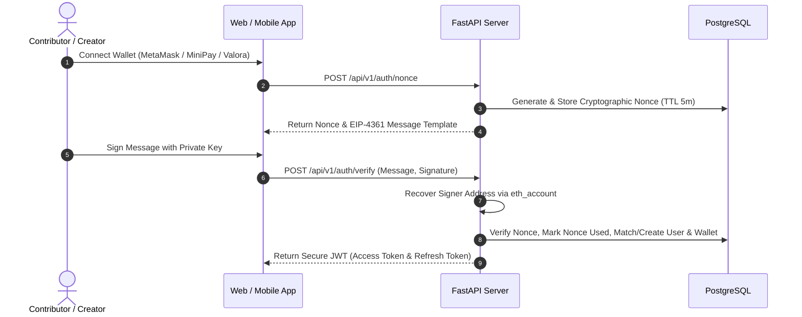

# DataMint Security & Threat Model

## 1. Authentication & Authorization

### 1.1 Non-Custodial EIP-4361 (SIWE) Flow
DataMint does not use passwords or custodial private keys. All authenticated actions are anchored to an Ethereum / Celo wallet signature using EIP-4361:

### 1.2 JWT Token Architecture
- **Access Tokens:** Short-lived (15 minutes), containing user UUID, primary wallet address, active capability claims, and session ID.
- **Refresh Tokens:** Long-lived (7 days), stored hashed in `auth_sessions`, revocable on logout or security events.

---

## 2. Threat Modeling & Mitigations

### 2.1 Replay Attacks & Signature Manipulation
- **Threat:** An attacker intercepts an EIP-4361 login signature or EIP-712 payout voucher and replays it.
- **Mitigation:**
  - Nonces are single-use and expire after 300 seconds.
  - Payout vouchers bind `submission_id`, `recipient_address`, `campaign_id`, `amount`, and `nonce`.
  - The smart contract records `claimedNonces[voucherHash]` to prevent duplicate on-chain redemptions.

### 2.2 Sybil Attacks & Submission Spam
- **Threat:** Automated scripts flood high-reward campaigns with synthetic or repetitive low-quality data.
- **Mitigation:**
  - Per-wallet and per-IP rate limits on submission creation.
  - Per-contributor submission caps per campaign (e.g. maximum 5 submissions per contributor per campaign).
  - SHA-256 asset deduplication (exact duplicate audio/images are rejected at upload stage).
  - Multi-stage validation: automated format checks + AI semantic evaluation.

### 2.3 Media Storage Privacy & Direct S3 Abuse
- **Threat:** Unauthorized users accessing contributor recordings or uploading malicious executables.
- **Mitigation:**
  - Contributor media files are stored in private, unexposed buckets.
  - Uploads require authenticated pre-signed PUT URLs with strict content-type and maximum byte-size constraints.
  - Direct downloads require short-lived pre-signed GET URLs accessible only to the campaign creator or authorized reviewers.
