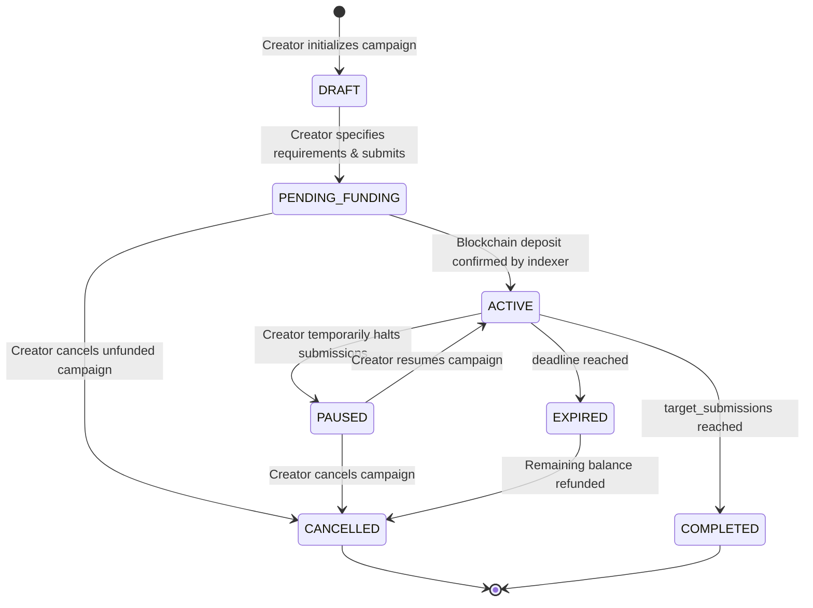
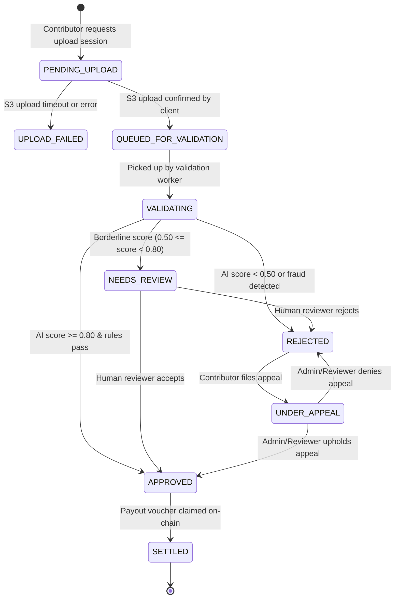

# DataMint State Machines

## 1. Campaign Lifecycle State Machine

A dataset campaign transitions through strictly enforced lifecycle states. Transitions cannot jump steps or proceed without required validation conditions.

### Campaign Transition Rules:
- **DRAFT $\to$ PENDING_FUNDING:** Allowed only if target submissions $> 0$, reward per submission $> 0$, and criteria schema is valid.
- **PENDING_FUNDING $\to$ ACTIVE:** Triggered exclusively by on-chain `Deposit` event confirmation where deposit amount $\ge (\text{target} \times \text{reward})$.
- **ACTIVE $\to$ COMPLETED:** Triggered automatically when approved submissions count equals `target_submissions`.

---

## 2. Submission Lifecycle State Machine

A contributor submission flows from initialization to AI validation, optional human review, and final settlement.

### Submission Transition Invariants:
- `PENDING_UPLOAD $\to$ QUEUED_FOR_VALIDATION` requires validation of the asset's byte size, MIME type, and SHA-256 checksum.
- Transitioning to `APPROVED` synchronously reserves reward funds in `EscrowCampaign` and creates a signed `PayoutAuthorization`.
- Transitioning from `APPROVED $\to$ REJECTED` (e.g. via audit or dispute) triggers an `UNRESERVATION` ledger entry to return reserved funds to the available pool.

---

## 3. Payout Voucher Lifecycle State Machine

Payouts follow a non-custodial pull-payment model using signed EIP-712 vouchers.

```mermaid
stateDiagram-v2
    [*] --> AUTHORIZED : Submission approved; Voucher signed
    AUTHORIZED --> CLAIMED : Contributor submits to smart contract
    AUTHORIZED --> EXPIRED : Claim window elapses (e.g., 30 days)
    EXPIRED --> REAUTHORIZED : Re-signed upon contributor request
    REAUTHORIZED --> CLAIMED
    CLAIMED --> [*]
```

